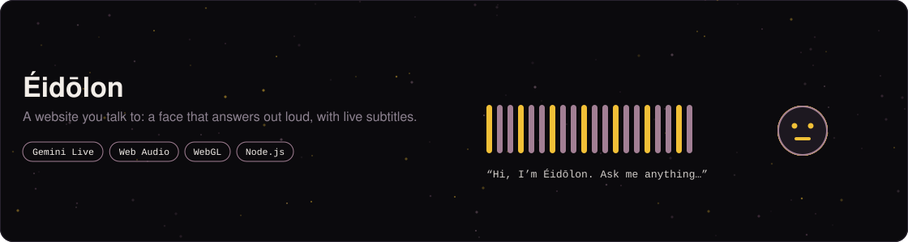
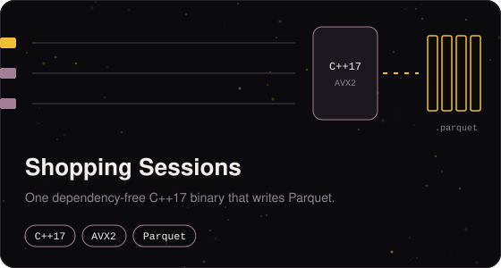

  

  
  
  

### 🐙 About me

Hi, I'm Jitesh — an industrial engineer based in New Jersey. Most of my work is figuring out why a real-world business process is broken and building the software to fix it.

I've spent the last five years running physical commodities trades across Asia, building production software, and leading product and AI work. Currently finishing my M.S. in Industrial & Systems Engineering at Rutgers.

> **Why tentechle?** Tentacle + tech: one brain, reaching into many industries — finance, energy, commodities, supply chain and AI.

- 🔭 **Building:** Amptally — turning messy EV charger and utility data into clean financial records
- 🏗️ **Founded:** Jitesh Enterprises — minerals and natural stone trading across Asia and Africa (2020–2024)
- 🎯 **Looking for:** senior roles in product, forward deployed engineering and technology delivery
- 📍 **Based in:** New Brunswick, NJ · open to remote or relocation

### 🛠️ Toolkit

  

      

### 🚀 Featured work

<table><tr><td colspan="2"></td></tr><tr><td width="50%"></td><td width="50%"></td></tr></table>

### 📜 Certifications

       

### 🐍 Contributions

<picture>
  <source media="(prefers-color-scheme: dark)" srcset="https://raw.githubusercontent.com/tentechle/tentechle/output/snake-dark.svg">
  
</picture>

More at <a href="https://jiteshrao.tech">jiteshrao.tech</a> · Engineer's hands. Product brain.

